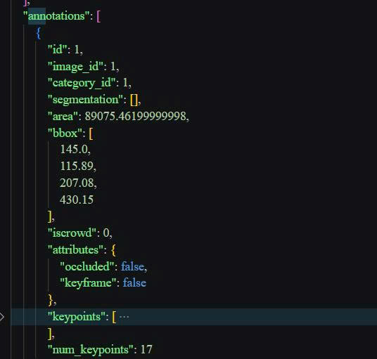

# Báo cáo cá nhân — HoVaTen-MSSV

Đổi tên file theo quy tắc `MSSV_HoTen.md`. Ví dụ: `20241234_NguyenVanAn.md`.

Dữ liệu: 12 ảnh người COCO val2017 (Lin et al., 2014) và 8 ảnh chân dung Wikimedia Commons, chỉ dùng trong lớp.

## 0. Thông tin học viên

- Họ tên: Bùi Anh Dũng
- MSSV: 2A202603033
- Email: buianhdung157@gmail.com
- Link repository:https://github.com/VinUni-AI20k/K5-L2-KeypointPose-Student
- Phiên bản CVAT (Help → About):2.82.1
- Máy: hệ điều hành _10 · RAM _16__ GB · chạy CVAT chế độ đầy đủ / lite
- Bộ ảnh (`src/exports/assignment.json` do `lab.py setup` tạo): có 
- Giờ bắt đầu: 
- Giờ kết thúc:

## 1. Kiểm tra label (CP0)

| Label | Kiểu | Số điểm | Tên điểm đúng bảng của lab? | Đúng thứ tự? | Số cạnh |
|---|---|---:|---|---|---:|
| `person` | Skeleton | 17 | có | có | 19 |
| `face` | Skeleton | 13 | có | có | 13 |

Mẫu `person` dựng theo người quay mặt về camera (các điểm `left_*` nằm bên phải khung mẫu)? Có 

- Trên CVAT, chọn từng keypoint trong mục PARTS rồi bật cờ Occluded nếu điểm bị che khuất hoặc Outside nếu điểm nằm ngoài khung hình; thao tác chỉ áp dụng cho điểm được chọn, không ảnh hưởng các điểm còn lại trong Skeleton.

## 2. Số lượng đã gán và thời gian (CP1, CP2)

| Nhóm ảnh | Số ảnh | Số skeleton đã gán | Số người dưới 60 px (không gán) | Số poster / gương / màn hình bỏ qua | Thời gian (phút) |
|---|---:|---:|---:|---:|---:|
| `easy` | 5 | 5 | 0 | 0 | 10  |
| `occluded` | 3 | 6 | 0 | 0 | 5 |
| `back` | 2 | 5 | 0 | 0 | 4 |
| `small` | 1 | 2 | 1 | 0 | 2 |
| `crowd` | 1 | 3 | 0 | 0 | 2 |
| `faces` | 8 | 8 | không áp dụng | không áp dụng | 10 |

- Số ảnh người đã xong ở mốc phút 105: _10__ / 10
- Thời gian thực tế (phút): CP1 _30__ · CP2 _50__ · CP3 _25__
- Ảnh tốn thời gian nhất là ảnh nào, vì sao?: 000000413160.jpg – nhóm Crowd, do có nhiều người nên mất thời gian phân biệt và gán keypoint chính xác.

## 3. Bảng ca khó (CP1, CP2)

Mỗi điểm bạn phân vân một dòng, nhất là phân vân giữa `v = 1` và `v = 0`, hoặc không chắc hướng người.

| Ảnh | Người / mặt | Điểm | Cờ đã chọn | Phân vân giữa | Lý do chọn |
|---|---|---|---:|---|---|
| 000000027565.jpg | Người 1 |left_ear | 1 | v=1 và v=0 | Không xác định được vị trí tai do bị khuất |
| 000000156986.jpg | Người 2 |left_eye | 2 | v=1 và v=2 | Nhìn vị trí mắt hơi bị mờ  |
| face_255797.jpg | Mặt | left_eye_uper, left_eye_lower, left_eye_inner, left_eye_outer,  right_eye_uper, right_eye_lower, right_eye_inner, right_eye_outer,| 1 | v=1 và v=0 | Đeo kính dâm không xác định vị trí mặt |

## 4. Bảng tự review (CP3)

Đi từ ảnh cuối về ảnh đầu. 5 ảnh người (ít nhất 2 ảnh `back` hoặc `crowd`) và 3 ảnh mặt. Ít nhất 8 dòng, kể cả dòng `ok`. Ghi lỗi trước, sửa sau.

Mã lỗi dùng đúng một trong: `lr_swap`, `vis_flag`, `position`, `missing`, `extra`, `ok`.

| Ảnh | Người / mặt | Điểm | Mã lỗi | Ghi chú | Đã sửa? |
|------|------|------|------|------|------|
| 000000431988.jpg | Person (skateboard) | ear | position | Điểm tai lệch nhẹ khỏi vị trí giải phẫu của đầu | Có |
| 000000431988.jpg | Person đứng bên phải | shoulder | vis_flag | Vai bị che một phần, cần kiểm tra lại visibility | Có |
| 000000580257.jpg | Person bên trái | ankle | vis_flag | Mắt cá chân bị che khuất một phần bởi tư thế bắt chéo chân | Có |
| 000000580257.jpg | Person bên trái | wrist | position | Cổ tay gần túi xách, điểm đặt hơi lệch khỏi khớp thực tế | Có |
| 000000580257.jpg | Person bên phải | toàn bộ | ok | Không phát hiện lỗi rõ ràng | chưa |
| 000000413160.jpg | Person áo vàng | hip | position | Điểm hông đặt hơi thấp so với khớp thực tế | Có |
| 000000413160.jpg | Person áo vàng | knee | vis_flag | Đầu gối bị che một phần, cần xem lại cờ visibility | Có |
| 000000123544.jpg | Person bên trái | wrist | position | Cổ tay đặt lệch nhẹ khỏi vị trí bàn tay đeo găng | Có |
| 000000123544.jpg | Person bên phải | hip | position | Hông phải nằm hơi lệch khỏi trục thân người | Có |
| 000000433787.jpg | Person | toàn bộ | ok | Keypoint và visibility phù hợp | chưa |


## Tổng hợp số lỗi theo mã

| lr_swap | vis_flag | position | missing | extra | ok |
|----------|----------|----------|----------|-------|----|
| 0 | 3 | 5 | 0 | 0 | 2 |


## 5. Kiểm file xuất và kết quả tự kiểm (CP4)

Tự kiểm tay trong file JSON:

| File | Người / mặt kiểm (ảnh, thứ tự) | Số phần tử `keypoints` | Điểm `outside` ra `v = 0`, `occluded` ra `v = 1`? | `num_keypoints` khớp? |
|---|---|---:|---|---|
| `BuiAnhDung_persons.zip` | 000000431988.jpg - Person 1 | 51 | Có | Có |
| `BuiAnhDung_persons.zip` | 000000580257.jpg - Person 361 | 51 | Có | Có |
| `BuiAnhDung_faces.zip` | 01 face kiểm tra ngẫu nhiên | 39 | Có | Có |

Sau khi xuất, CVAT ghi `occluded` thành `v = 1` và `outside` thành `v = 0`.

Tọa độ của điểm `outside` trong file là tọa độ cũ, không tự động đổi về `(0, 0)`.

Hai job đã chuyển sang completed trên CVAT?  Có.

Dán phần **TÓM TẮT** in ra từ `src/check_submission.py`:

```text
(chưa có output check_submission.py để đối chiếu)
```

Các `[CẢNH BÁO]` còn giữ nguyên và lý do:

- Không còn cảnh báo sau khi hoàn thành rà soát và chỉnh sửa annotation.

## 6. Ảnh chụp màn hình

1. Label `person` trong label constructor (đủ 17 điểm có tên):

   

2. Một người quay lưng đã gán, cờ đã đặt:

   

3. Một khuôn mặt đã gán 13 điểm, phóng to vùng mắt:

   

4. Một đoạn JSON xuất của một người:

   

Nguồn ảnh: COCO val2017 / Wikimedia Commons.

## 7. Tự đánh giá

1. Lỗi bạn mắc nhiều nhất hôm nay, và cách bạn sẽ tránh ở dự án thật:

 - Lỗi tôi mắc nhiều nhất là xác định chưa nhất quán cờ visibility (v=0, v=1, v=2) đối với các keypoint bị che khuất một phần. Trong một số trường hợp khớp vẫn có thể suy luận được vị trí nhưng tôi phân vân giữa việc đánh dấu occluded hay outside.
- Ở các dự án thật, tôi sẽ phóng to ảnh trước khi gán nhãn, kiểm tra kỹ hướng của các đoạn xương liên kết và áp dụng thống nhất quy tắc:
- v=2: nhìn thấy rõ vị trí điểm.
- v=1: bị che khuất một phần nhưng vẫn xác định được vị trí.
- v=0: không xác định được vị trí hoặc điểm nằm ngoài ảnh.
- Ngoài ra tôi sẽ tự review một lượt toàn bộ annotation trước khi xuất file để giảm các lỗi visibility.

2. Một quy tắc bạn đề xuất thêm vào guideline (kèm ảnh ví dụ nếu có):

- Tôi đề xuất bổ sung một quy tắc riêng cho các trường hợp tư thế quay lưng.
- Đề xuất: Khi người quay lưng hoàn toàn, việc xác định trái - phải phải dựa trên cơ thể của đối tượng thay vì góc nhìn của người gán nhãn.
- Ví dụ:
- Vai trái của người vẫn là vai trái dù xuất hiện ở phía bên phải màn hình.
- Gối trái, mắt cá trái và các khớp khác cũng tuân theo nguyên tắc tương tự.
- Quy tắc này giúp giảm lỗi lr_swap, đặc biệt ở các ảnh back hoặc các tư thế xoay người mạnh.

3. Nhãn của bạn đi vào model ở đâu? Chọn một lỗi bạn đã sửa và nói nó sẽ làm model học sai thế nào (heatmap, trọng số trong loss, hay bước lật ảnh)

- Một lỗi tôi đã sửa là điểm hông (hip) bị đặt lệch khỏi vị trí khớp ở ảnh 000000413160.jpg.

- Nếu giữ nguyên lỗi này:
- Heatmap của keypoint hông sẽ được tạo tại vị trí sai.
- Trong quá trình huấn luyện, loss sẽ khuyến khích mô hình dự đoán vị trí sai đó là đúng.
- Khi tích lũy trên nhiều ảnh, mô hình có thể học sai phân bố vị trí của khớp hông, làm giảm độ chính xác khi dự đoán tư thế người.
- Vì vậy việc chỉnh đúng vị trí keypoint trước khi xuất dữ liệu là rất quan trọng để bảo đảm chất lượng nhãn và hiệu quả huấn luyện của mô hình.

## 9. Tài liệu tham khảo và công cụ AI đã dùng

- Tài liệu tham khảo
Tài liệu hướng dẫn bài thực hành Keypoint Pose – VinUni AI.
README.md, RULES.md và CHECKPOINTS.md trong repository bài tập.
Định dạng COCO Keypoints 1.0.

- Công cụ đã sử dụng
CVAT: Gán nhãn keypoint cho người và khuôn mặt.
Docker: Khởi chạy môi trường CVAT cục bộ.
Python: Chạy các script kiểm tra, thiết lập và xuất dữ liệu.
PowerShell: Thực hiện các lệnh quản lý và kiểm tra dự án.
ChatGPT: Hỗ trợ giải thích yêu cầu bài tập, hướng dẫn thao tác CVAT, xử lý lỗi kỹ thuật và hỗ trợ trình bày báo cáo.